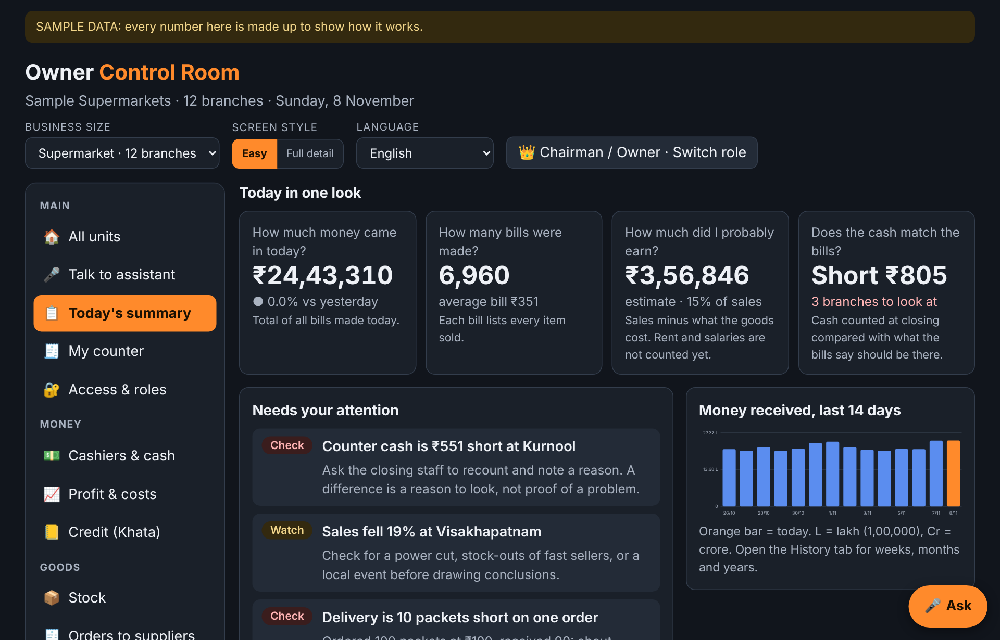
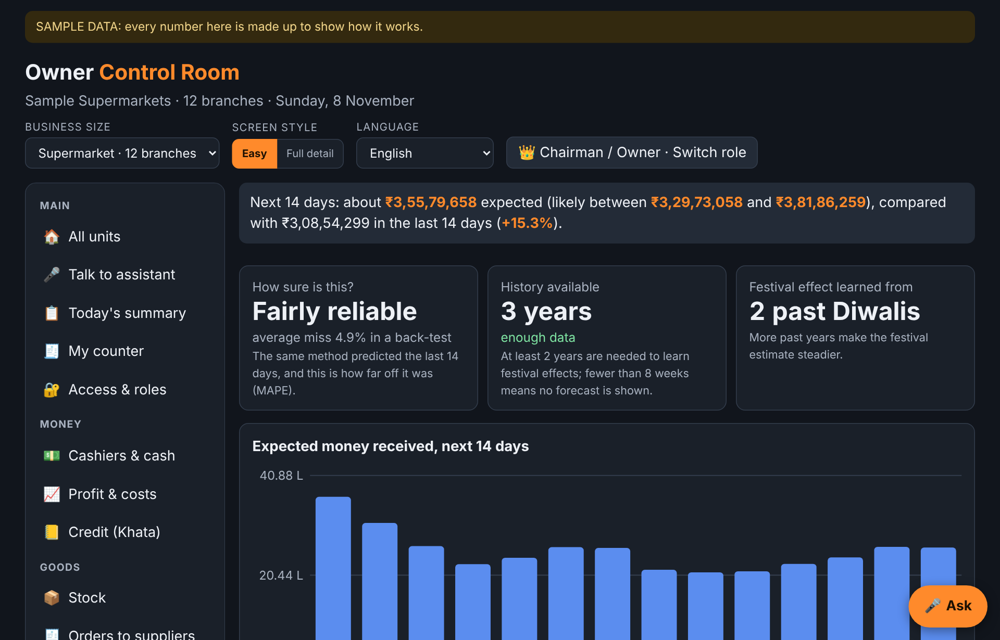
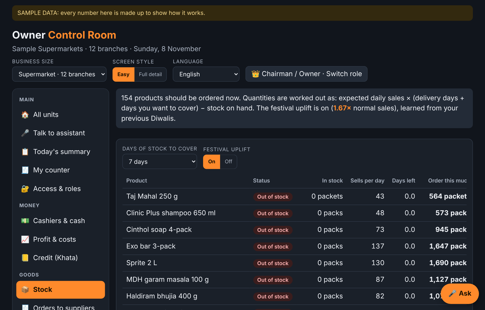
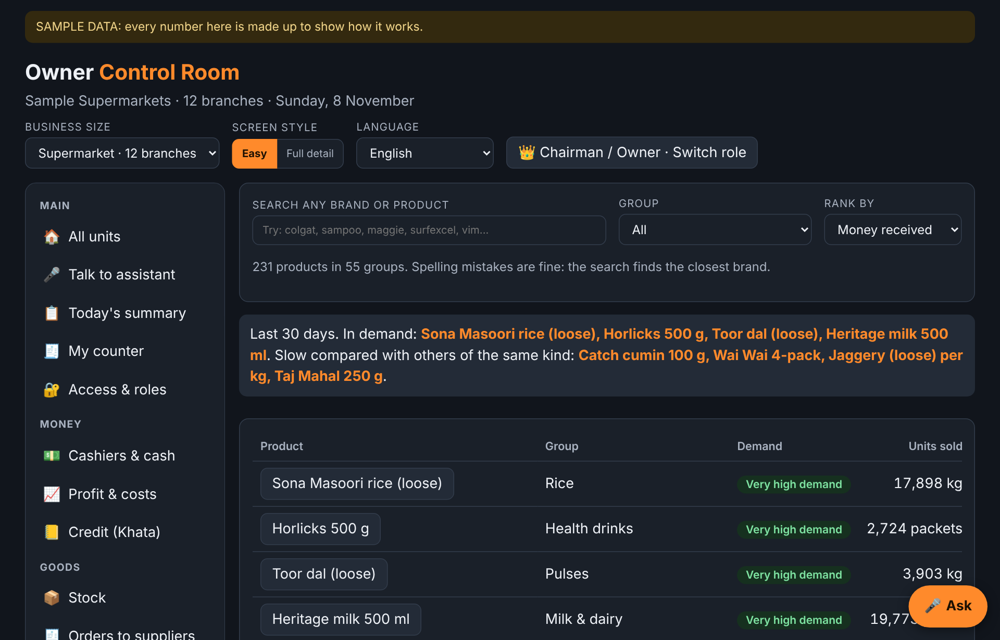
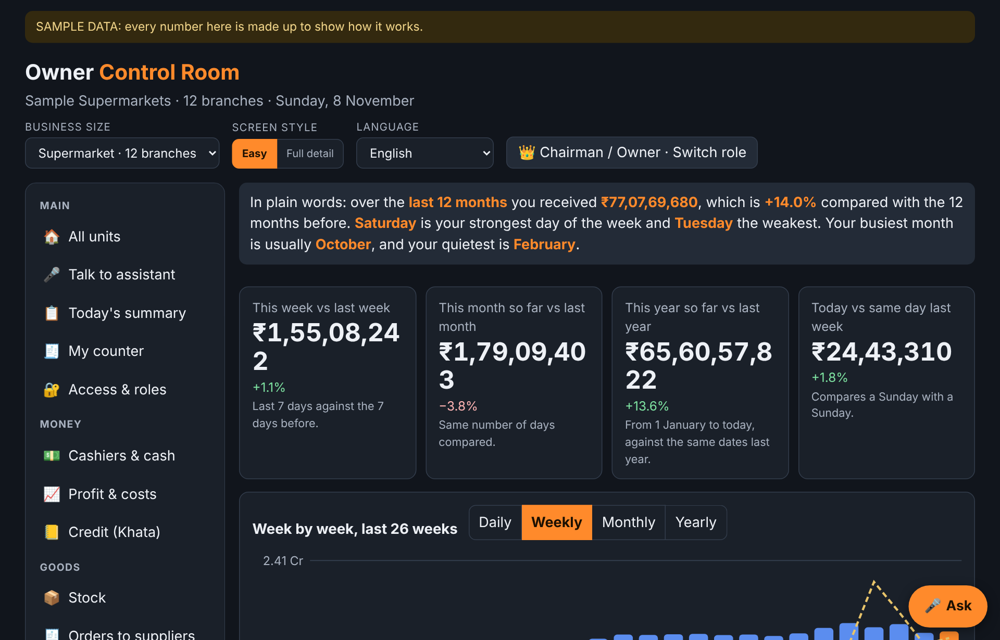

# 🏪 Dukan Drishti
### An owner's control room for Indian retail: kirana, supermarket and chain

> **Know your shop in 30 seconds, and know *why*.** A zero-dependency Python engine + REST API + a live owner dashboard that turns bills, stock, credit and cash into plain-language answers with the reason attached. Everything runs on synthetic data, so it is safe to explore, fork and demo.

[](https://github.com/25A31A05GA/dukan-drishti/actions)
   

**[▶ Live demo](https://dukan-drishti.vercel.app/)** · [Our journey](docs/JOURNEY.md) · [Project report](docs/REPORT.md) · [Case studies](docs/case-studies/README.md) · [Slide deck](docs/Dukan_Drishti.pptx) · [API](docs/API.md) · [Architecture](docs/ARCHITECTURE.md)



---

## Why this exists

Dukan *Drishti* means "the shopkeeper's eye". Most shop owners cannot sit in every branch, read every bill, or trust a number they cannot explain. This project turns the daily mess (bills, stock, credit, cash, offers) into **plain-language answers with a reason attached**: what sold, what to reorder, whether an offer really earned money, which cashier's drawer is short, and what the next two weeks may bring.

> All data is **synthetic**. Every screen says so. A verdict is a lead to check, never proof of anything.

A shop owner usually gets numbers without reasons: sales are up, but is it the festival, the offer or the price? Stock is low, but how much should be ordered before Diwali? A cashier's drawer is short, but is it a pattern or a bad day? **A number you cannot explain is a number you cannot act on**, so every screen here shows the answer, the working and the limits.

## What it does

| Question an owner asks | Module | Plain answer it gives |
|---|---|---|
| How much did we sell, and where is it going wrong? | `world`, `brief` | Traffic-light for every branch, and a 30-second morning brief |
| What will the next 14 days bring? | `forecast` | Expected sales **with a back-tested range**; shows "not enough data" instead of guessing |
| What should I order, and how much? | `stock` | Daily sales x (delivery days + cover days) - stock on hand, with a Diwali uplift |
| Which brand is really in demand? | `insights` | Verdict **and reasons** (price gap, stock-outs, offer days, growth, margin) |
| Does one supply source sell more because it is better? | `insights` | A fairness test: price, shelf, stock and offers are separated from quality signals |
| Did the Diwali offer pay for itself? | `insights` | Extra sales against the discount given away |
| Which supplier delivers short? | `insights` | Ranked, and says a short delivery is not proof of dishonesty |
| Who owes me money? | `ledger` | Ageing buckets and a ready WhatsApp reminder |
| What is about to expire? | `ledger` | Markdown action by days left |
| Is a cash drawer short? | `cash` | Which branch, counter and cashier, framed as a lead not blame |
| What do I really keep? | `finance` | Profit after running costs, break-even sales per day, GST to set aside |
| Am I priced right? | `pricewatch` | Where you are clearly below the market and the extra profit a rise could add |
| Who may see what? | `access` | Seven roles; a cashier cannot open profit, a branch manager cannot see supplier dues |
| Can I just ask? | `assistant`, `search` | Plain-English questions, and typo-tolerant product search ("horlix", "sona masuri") |

**Built to avoid wrong answers**, and each rule has a test:
- The forecast says "not enough data" instead of guessing, and shows a back-tested range
- Supply-source comparisons separate price, shelf, stock and offers from real quality signals
- Supplier and cash-drawer findings are worded as leads to check, never blame
- A cashier cannot open profit and a branch manager cannot see supplier dues (seven roles)
- Typo search refuses random letters instead of returning a random product

## Quick start

```bash
git clone https://github.com/25A31A05GA/dukan-drishti.git && cd dukan-drishti
python -m dukan_drishti brief                 # the owner's morning brief
python -m dukan_drishti ask "which brand sells least"
python -m dukan_drishti search horlix
python -m dukan_drishti serve --port 8080     # REST API at http://localhost:8080
python -m unittest discover -s tests          # 80 tests, about 10 seconds
```

Needs only Python 3.11+ (tested on 3.13). No `pip install` for running or testing.
Add `--size kirana|super|chain` to any command (1, 12 or 100 branches).

## Does it work? (measured, and honest about the limits)

| Check | Result |
|---|---|
| Python vs the dashboard's own JavaScript (sales, 231 products, forecast, back-test, offers, verdicts, reorder plan) | Match to 12 decimal places, tested at every run |
| Python vs the numbers the dashboard prints on its profit, cash, price, credit, expiry, history and supplier screens | Match (text-parity tests) |
| Forecast back-test miss (median, 60 dates) | **6.2% supermarket, 6.0% chain, 12.3% single kirana shop** |
| Typo search: right product in top 3 | 95.3% (top 1: 86.5%, exact word: 97.5%) |
| Random letters wrongly returning a product | 1.25% |

> ⚠️ **Read this honestly.** The data is synthetic and generated by the same rules the engine learns from, so these numbers show the code works *as designed*, not that it would score the same on a real shop's bills.

A single small shop is **noisy**: its forecast reads "rough guide" and the range is wide. That is the tool being honest, not broken. Details and every failure along the way: [docs/REPORT.md](docs/REPORT.md) and [docs/JOURNEY.md](docs/JOURNEY.md). Reproduce the numbers with `python -m dukan_drishti bench`.

## How it works

```
World (synthetic: branches, 3+ yrs of sales, 231 products, festivals)
   ├─► forecast (level x weekday x festival lift x growth) ─► back-test ─► range / "not enough data"
   ├─► stock (daily x (lead + cover) - on hand, Diwali uplift) ─► reorder plan
   ├─► insights / ledger / cash / finance / pricewatch ─► verdict + reasons
   └─► access (7 roles) ─► api.py (REST) ─► dashboard, CLI, plain-English assistant
```

Full walkthrough in [docs/ARCHITECTURE.md](docs/ARCHITECTURE.md).

## Screens

| Forecast | Stock & reorder |
|---|---|
|  |  |
| **Brands & products** | **Sales history** |
|  |  |

## Project layout

```
dukan_drishti/     the engine (standard library only)
  world.py           branches, 3+ years of daily sales, 231-product catalog
  forecast.py        14-day forecast + back-test      stock.py     reorder plan
  insights.py        brands, sources, offers, suppliers   ledger.py   khata, expiry
  cash.py finance.py pricewatch.py history.py access.py   search.py  assistant.py  brief.py
  api.py             REST API (styled pages for browsers, JSON for programs)
  bench.py           the honest self-checks
tests/             80 tests + fixtures computed by the dashboard itself
docs/              website: home, dashboard, report, journey, case studies, slides
scripts/           build_site.py (Markdown to HTML), run.sh
deploy/            render.yaml (API), vercel.json is in the repo root
```

## Deploy

- **Website on Vercel (done):** import the repo at [vercel.com/new](https://vercel.com/new). `vercel.json` serves the `docs/` folder. Live: https://dukan-drishti.vercel.app/
- **API on Render (optional):** New → Blueprint → pick this repo (`deploy/render.yaml`, uses the `Dockerfile`). Then open `/api/health`. Vercel cannot host this long-running Python server, so the website and API live in two places.
- **Docker:** `docker build -t dukan-drishti . && docker run -p 8080:8080 dukan-drishti`

## Limitations (please read)

- Synthetic data only. It has not been tested on a real shop's bills.
- A planted-pattern benchmark proves the code works as designed, not that it matches a real business.
- The forecast ignores holidays other than the four listed festivals and cannot see one-off events.
- No database, login or WhatsApp sending yet. The reminder link opens WhatsApp with the text filled in.

## Roadmap
Import real bills from CSV · Telugu and Hindi voice questions in Python · SQLite storage · scheduled morning brief to WhatsApp · price-walk entry form.

## The story behind it

What we tried, what failed and what it fixed: read **[Our journey](docs/JOURNEY.md)**, the **[project report](docs/REPORT.md)** and the **[case studies](docs/case-studies/README.md)**. Examples: a search that returned nothing for "horlix", a prefix rule that lowered accuracy before it was rewritten, and a "worse in festivals" claim we checked and corrected.

## Responsible use

Synthetic data only. Never commit real customer or shop data. See [SECURITY.md](SECURITY.md).

## Contributing & license

PRs welcome, see [CONTRIBUTING.md](CONTRIBUTING.md). MIT licensed. Built by **Sairam Saladi** ([@25A31A05GA](https://github.com/25A31A05GA)).

⭐ If this helped or inspired you, a star helps others find it.
